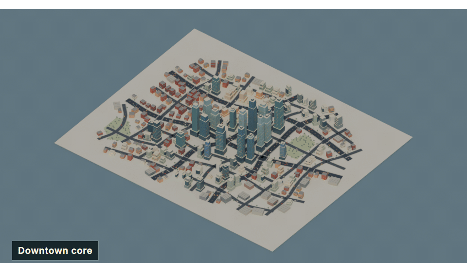
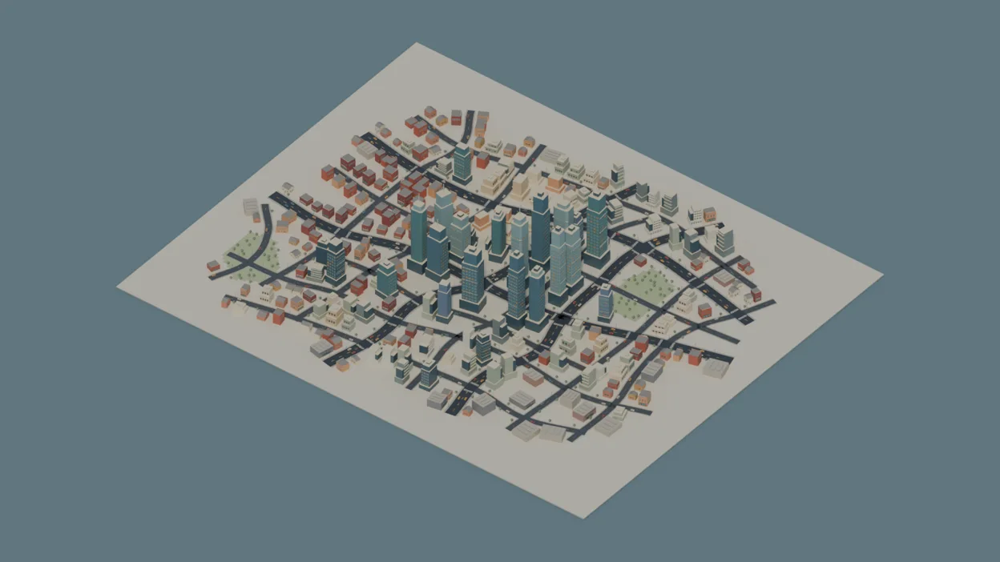
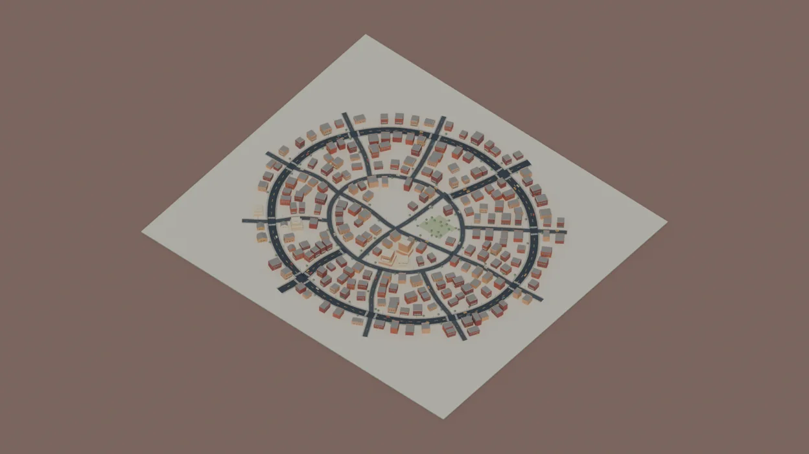
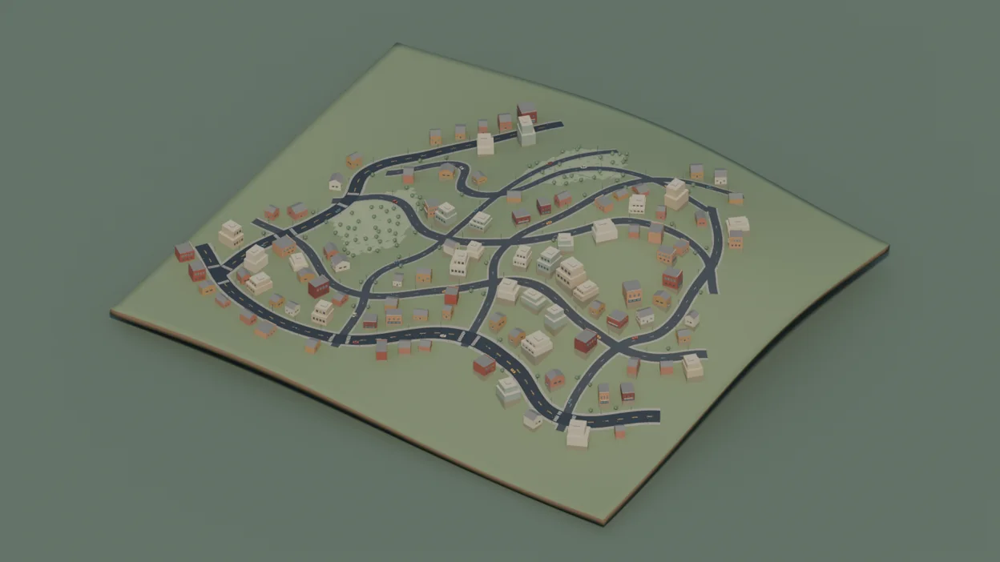

# City Blockout Studio

Sketch roads and build a live, editable city in **Blender 5.0+**.

**[Download the add-on](downloads/city-blockout-studio.zip?raw=true)** · [Editable sample](downloads/city-blockout-studio-sample.blend?raw=true) · [Quick start](docs/quick-start.md)

- **Draw the roads.** Sketch with junction snapping, import curves, and tune the width and building style on each side.
- **Shape the city.** Paint or draw districts, fill enclosed blocks, and reserve parks or empty lots. Mix housing, offices, skyscrapers, civic buildings, and warehouses.
- **Dial in the detail.** Adjust density, height, façades, trees, crosswalks, streetlights, and static traffic. Start flat or use experimental terrain projection.
- **Bake and edit.** Turn the city into grouped meshes with individual buildings and cars, local origins, and copied materials.

Install the ZIP via **Preferences → Get Extensions → Install from Disk**. Open **N → City Blockout → Load Starter City**.

| Downtown | Old town | Hillside |
| --- | --- | --- |
|  |  |  |
